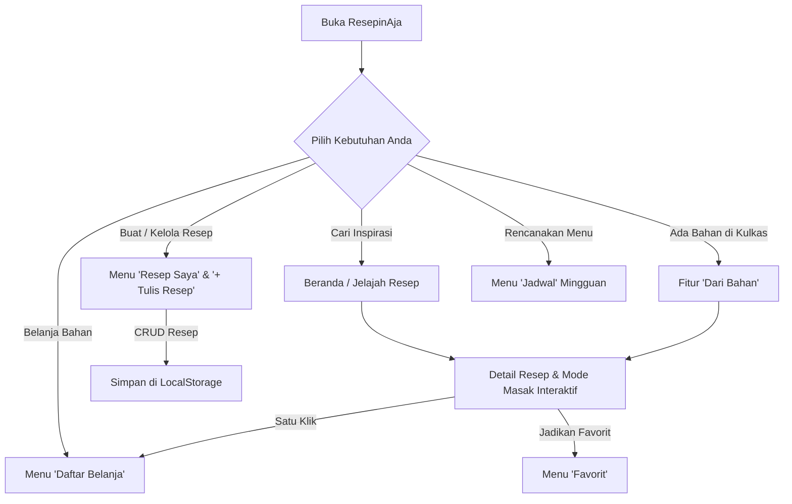

<div align="center">

# 🍳 ResepinAja
### *Find Recipes. Cook with Ease.*

Platform penemuan resep masakan, perencanaan menu harian, dan pencatatan belanja berbasis **Progressive Web App (PWA)** dengan kemampuan **Offline-First**.

[](https://reactjs.org/)
[](https://vitejs.dev/)
[](https://tailwindcss.com/)
[](https://web.dev/progressive-web-apps/)
[](https://github.com/dkaastyns/ResepinAja)
[](https://vercel.com/)

---

</div>

## 📌 Daftar Isi
1. [Tentang Proyek](#-tentang-proyek)
2. [Identitas Pengembang & Kelompok](#-identitas-pengembang--kelompok)
3. [Panduan Lengkap Cara Menggunakan Aplikasi](#-panduan-lengkap-cara-menggunakan-aplikasi)
4. [Implementasi Operasi CRUD & Lokasinya](#-implementasi-operasi-crud-create-read-update-delete)
5. [Fitur Utama Aplikasi](#-fitur-utama-aplikasi)
6. [Tampilan Antarmuka & UX Mewah](#-tampilan-antarmuka--ux-mewah)
7. [Spesifikasi Teknologi (Tech Stack)](#-spesifikasi-teknologi-tech-stack)
8. [Struktur Folder Proyek](#-struktur-folder-proyek)
9. [Panduan Instalasi & Menjalankan Lokal](#-panduan-instalasi--menjalankan-lokal)
10. [Fitur PWA & Offline Support](#-fitur-pwa--offline-support)
11. [Panduan Deployment ke Vercel](#-panduan-deployment-ke-vercel)

---

## 📖 Tentang Proyek

**ResepinAja** adalah aplikasi web modern yang dirancang untuk memecahkan kebingungan harian: *"Hari ini mau masak apa?"*. Aplikasi ini memudahkan pengguna menemukan resep masakan nusantara maupun mancanegara berdasarkan bahan yang ada di kulkas, mengelola resep pribadi dengan operasi **CRUD lengkap**, merancang jadwal menu makan mingguan, serta menyusun daftar belanja bahan secara otomatis.

Dikembangkan dengan pendekatan **Mobile-First & Desktop-Responsive PWA**, aplikasi ini dapat diinstal di smartphone maupun laptop layaknya aplikasi *native*, serta dapat diakses penuh meskipun perangkat dalam kondisi **offline tanpa koneksi internet**.

### 🎯 Target Pengguna
- **Mahasiswa**: Membutuhkan ide masakan praktis, hemat, dan memanfaatkan bahan yang ada di kos.
- **Pekerja Sibuk**: Membutuhkan resep cepat saji (≤ 20 menit) untuk sarapan atau makan malam.
- **Ibu Rumah Tangga / Keluarga**: Perencanaan variasi menu mingguan dan daftar belanja kebutuhan dapur.
- **Pencinta Kuliner**: Menyimpan dan mendokumentasikan kreasi resep pribadi.

---

## 👥 Identitas Pengembang & Kelompok

| Data Mahasiswa | Keterangan |
| :--- | :--- |
| **Nama Lengkap** | **Ahmad Dika Styansah** |
| **NIM** | **21120124130052** |
| **Kelompok** | **Kelompok 23** |
| **Email** | `dikatzy@gmail.com` |
| **Program Studi** | Teknik Komputer |
| **Fakultas / Universitas** | Fakultas Teknik / Universitas Diponegoro |
| **Mata Kuliah** | Praktikum Pemrograman Perangkat Bergerak |

> 💡 **Info Kontak**: Halaman **Info Kontak** telah tersedia di aplikasi (`/kontak`) yang menampilkan profil pengembang, kontak email (`dikatzy@gmail.com`), tautan GitHub, dan fasilitas salin cepat identitas pengembang.

---

## 🎮 Panduan Lengkap Cara Menggunakan Aplikasi

Berikut adalah alur panduan langkah demi langkah untuk memaksimalkan seluruh fitur di **ResepinAja**:



### 1. Mencari & Menjelajahi Resep
1. **Pencarian Cepat di Beranda (`/`)**:
   - Ketik nama hidangan pada kolom pencarian hero (contoh: *"nasi goreng"*, *"rendang"*).
   - Klik chip kategori cepat seperti *Makanan Cepat ≤20m*, *Cari dari Bahan*, atau *Rencana Menu*.
2. **Jelajah Terstruktur (`/jelajah`)**:
   - Buka menu **Jelajah** pada navbar.
   - Gunakan filter kategori (*Makanan Utama, Sarapan, Camilan, Minuman, Dessert, Sup & Soto, Seafood, Vegetarian*).
   - Gunakan filter tingkat kesulitan (*Mudah, Sedang, Sulit*) serta pengurutan (*Terbaru, Terlama, Waktu Tercepat, Nama A-Z*).
   - **Paginasi Cerdas**: Hasil resep dibatasi **maksimal 8 item per halaman** agar tampilan rapi, ringan, dan tidak memberatkan peramban. Gunakan tombol nomor halaman atau *Sebelumnya / Selanjutnya* untuk berpindah halaman.

### 2. Memasak dengan Mode Interaktif (`/resep/:id`)
1. Klik salah satu kartu resep untuk membuka halaman detail.
2. **Pengatur Porsi Otomatis (*Servings Scaler*)**: Tekan tombol `−` atau `+` pada porsi. Takaran semua bahan (gram, butir, sdm) akan otomatis dikalkulasi ulang secara proporsional.
3. **Mode Memasak Interaktif**: Pindah ke tab *"Langkah Memasak"*, lalu centang setiap tahapan yang sudah selesai dilakukan. Aplikasi menyediakan bilah kemajuan (*progress bar*) dan efek selebrasi saat hidangan tuntas dimasak!
4. **Kirim ke Daftar Belanja**: Klik tombol **"Ke Daftar Belanja"** untuk mengekspor seluruh bahan masakan ke daftar belanja hanya dengan satu ketukan.

### 3. Mencari Resep dari Bahan yang Tersedia (`/dari-bahan`)
1. Buka menu **Dari Bahan**.
2. Masukkan bahan-bahan yang Anda miliki di kulkas (misal: *telur, bawang, ayam*).
3. Klik tombol **Cari Resep**.
4. Sistem akan mengurutkan resep berdasarkan **persentase kecocokan (*match percentage*)** tertinggi.

### 4. Membuat & Mengelola Resep Sendiri (`/resep-saya`)
1. Klik tombol hijau **"+ Tulis Resep"** pada kapsul navigasi atas atau navigasi bawah.
2. Isi formulir: judul resep, deskripsi, URL foto makanan, kategori, durasi persiapan & memasak, jumlah porsi, tingkat kesulitan, daftar bahan (nama, jumlah, satuan), serta langkah instruksi.
3. Klik **"Simpan Resep"**. Resep Anda akan langsung tersimpan dan memiliki lencana khusus *"Resep Saya"*.
4. Anda dapat mengedit kembali (*Update*) atau menghapusnya (*Delete*) kapan pun.

### 5. Mengatur Jadwal Makan Mingguan (`/jadwal`)
1. Buka menu **Jadwal**.
2. Pilih hari (Senin s.d. Minggu).
3. Pada tiap slot waktu (*Sarapan 🌅, Makan Siang ☀️, Makan Malam 🌙, Camilan 🍪*), klik tombol **"+ Tambah Menu"**.
4. Pilih hidangan dari koleksi resep yang tersedia. Menu terjadwal akan tersimpan rapi untuk memandu hari-hari Anda.

### 6. Mengelola Daftar Belanja (`/belanja`)
1. Buka menu **Belanja**.
2. Bahan dapat berasal otomatis dari resep yang diekspor atau ditambahkan secara manual melalui form input.
3. Saat berbelanja di pasar/supermarket, centang kotak belanjaan yang sudah dimasukkan ke keranjang.
4. Gunakan tombol **"Hapus yang Selesai"** untuk membersihkan bahan yang sudah dibeli.

### 7. Cadangkan & Pulihkan Data (`/pengaturan`)
- Buka menu **Pengaturan** (ikon gerigi).
- **Ekspor Data**: Klik *Ekspor Cadangan (.json)* untuk mengunduh seluruh data resep, favorit, jadwal, dan belanja ke komputer/HP Anda.
- **Impor Data**: Unggah file `.json` cadangan untuk memulihkan seluruh data Anda sewaktu-waktu.

---

## 🔄 Implementasi Operasi CRUD (Create, Read, Update, Delete)

Aplikasi **ResepinAja** mengimplementasikan operasi data **CRUD secara penuh, menyeluruh, dan persisten** menggunakan HTML5 LocalStorage *(Offline-First Architecture)*. 

Berikut adalah **Matriks Lokasi & Penjelasan Operasi CRUD** di dalam aplikasi:

| Modul Fitur | ➕ Create (Buat) | 👁️ Read (Tampilkan) | ✏️ Update (Ubah) | 🗑️ Delete (Hapus) |
| :--- | :--- | :--- | :--- | :--- |
| **1. Resep Pengguna (Core CRUD)** | Tombol `+ Tulis Resep` di Navbar atau `/resep-saya` | Beranda (`/`), Jelajah (`/jelajah`), Resep Saya (`/resep-saya`), & Detail (`/resep/:id`) | Tombol `Edit` (ikon pensil) pada kartu resep di `/resep-saya` atau halaman detail resep pribadi | Tombol `Hapus` (ikon sampah merah) pada kartu resep dengan modal konfirmasi keamanan |
| **2. Daftar Belanja (Shopping List)** | Input form manual di `/belanja` ATAU tombol `+ Ke Daftar Belanja` di detail resep | Daftar belanja di `/belanja` lengkap dengan counter item belum & sudah dibeli | Centang/uncheck status beli (selesai vs belum) dan penyesuaian jumlah bahan | Tombol sampah per baris item, tombol `Hapus yang Selesai`, & tombol `Bersihkan Semua` |
| **3. Jadwal Menu (Meal Planner)** | Klik tombol `+ Tambah` pada slot Sarapan/Siang/Malam/Camilan per hari | Tampilan kalender mingguan interaktif (Senin–Minggu) di `/jadwal` | Klik ganti menu pada slot jadwal untuk menimpa hidangan yang dipilih | Tombol silang `(X)` pada kartu menu terjadwal untuk menghapus menu dari slot |
| **4. Resep Favorit** | Klik ikon hati (❤️) pada kartu resep atau detail resep | Galeri resep favorit di halaman `/favorit` dan counter live di beranda | Toggle status favorit (aktif / non-aktif) secara instan | Klik kembali ikon hati (❤️) untuk membatalkan/menghapus resep dari daftar favorit |
| **5. Profil Pengguna** | Inisialisasi profil default otomatis saat aplikasi pertama kali dibuka | Halaman `/profil` menampilkan Nama, NIM, Kelompok, Email, dan Statistik | Formulir edit profil di `/profil` untuk mengubah Nama, NIM, Kelompok, dan Email | Tombol `Batal` / modifikasi field kembali ke nilai awal |
| **6. Ekspor / Impor / Reset** | Ekspor cadangan database lokal ke file `.json` | Membaca isi file cadangan `.json` via dialog file picker | Impor dan sinkronisasi data dari file cadangan ke LocalStorage | Fitur `Reset Semua Data` di `/pengaturan` untuk menghapus seluruh data aplikasi |

---

### 🔍 Rincian Teknis Implementasi CRUD Resep

#### 1. CREATE (Tambah Resep Baru)
- **Komponen**: `src/components/forms/RecipeForm.jsx` & `src/pages/MyRecipes.jsx`
- **Hook**: `src/hooks/useRecipes.js` ➔ fungsi `addRecipe(newRecipeData)`
- **Validasi**: Judul wajib diisi, minimal 1 bahan masakan, minimal 1 tahapan instruksi, validasi durasi memasak dan porsi.
- **Penyimpanan**: Menghasilkan ID unik (`recipe_user_${Date.now()}`), menambahkan flag `isUserRecipe: true`, timestamp `createdAt`, lalu disimpan ke `resepinaja_user_recipes` di LocalStorage.

#### 2. READ (Membaca & Menampilkan Resep)
- **Komponen**: `src/pages/Explore.jsx`, `src/pages/Home.jsx`, `src/pages/MyRecipes.jsx`, `src/pages/RecipeDetail.jsx`
- **Hook**: `useRecipes()` ➔ mengembalikan `allRecipes` (hasil penggabungan 12 resep bawaan + seluruh resep buatan pengguna).
- **Fitur Tambahan**: Dilengkapi filter kategori, filter kesulitan, pencarian teks, pengurutan, serta **paginasi 8 item per halaman** di halaman Jelajah.

#### 3. UPDATE (Mengubah Resep yang Ada)
- **Komponen**: `src/components/forms/RecipeForm.jsx` (mode edit)
- **Hook**: `src/hooks/useRecipes.js` ➔ fungsi `updateRecipe(recipeId, updatedData)`
- **Alur Kerja**: Saat tombol pensil ditekan, form dimuat dengan state data resep yang dipilih. Setelah disimpan, field `updatedAt` diperbarui dan state aplikasi langsung disinkronkan tanpa reload halaman.

#### 4. DELETE (Menghapus Resep)
- **Komponen**: `src/components/ui/Modal.jsx` & `src/pages/MyRecipes.jsx`
- **Hook**: `src/hooks/useRecipes.js` ➔ fungsi `deleteRecipe(recipeId)`
- **Keamanan**: Dilengkapi **dialog konfirmasi modal**. Data hanya dihapus dari LocalStorage jika pengguna menekan tombol konfirmasi merah *"Ya, Hapus"*. Notifikasi toast mengambang akan memberi umpan balik instan bahwa resep berhasil dihapus.

---

## 🚀 Fitur Utama Aplikasi

Sesuai dengan *Product Requirements Document (PRD)*, ResepinAja memiliki fitur komprehensif:

### 1. 🏠 Home / Dashboard
- **Animasi Startup**: Splash screen animasi topi koki dengan bilah proses pembuka saat aplikasi pertama kali dimuat.
- **Personalized Greeting**: Ucapan selamat pagi/siang/sore/malam dinamis sesuai jam pengguna.
- **Hero Search Bar**: Kolom pencarian resep instan dengan kata kunci saran populer.
- **Live Counter Banner**: Statistik langsung total koleksi resep, jumlah kategori, dan total resep favorit.
- **Kategori Masakan Interaktif**: Pilihan 8 kategori masakan dengan ikon dan warna khas.
- **Resep Rekomendasi Hari Ini**: Kartu resep sorotan (*featured card*) bergaya modern.
- **Resep Populer, Cepat (≤ 20 Menit), & Terbaru**: Pembagian kurasi resep sesuai kebutuhan waktu.

### 2. 🔍 Recipe Explorer & Pagination
- Pencarian cerdas berdasarkan nama resep, bumbu, atau kategori.
- Filter multi-kategori: *Makanan Utama, Sarapan, Camilan, Minuman, Dessert, Sup & Soto, Seafood, Vegetarian*.
- Filter tingkat kesulitan: *Mudah, Sedang, Sulit*.
- Pengurutan (*Sorting*): *Terbaru, Terlama, Waktu Tercepat, Nama A-Z, Nama Z-A*.
- **Paginasi Terbatas (Maksimal 8 Item / Halaman)**: Memastikan performa rendering tetap ringan, rapi, dan responsif di perangkat seluler maupun laptop.

### 3. 📄 Recipe Detail Interaktif
- Foto makanan resolusi tinggi dengan efek *lazy loading blur-up*.
- Informasi waktu persiapan, waktu memasak, total durasi, dan tingkat kesulitan.
- **Dynamic Servings Scaler**: Pengatur porsi (`-` dan `+`) yang secara otomatis menghitung ulang takaran seluruh bahan masakan.
- **Interactive Cooking Mode**: Setiap langkah memasak dapat dicentang dengan bilah kemajuan (*progress bar*) dan notifikasi selebrasi saat semua langkah selesai.
- Tombol **"Ke Daftar Belanja"**: Memasukkan seluruh bahan resep ke daftar belanja hanya dengan sekali klik.
- Tombol **Bagikan Tautan**: Salin tautan resep langsung ke papan klip (*clipboard*).

### 4. 🥦 Ingredient Search (Cari dari Bahan)
- Masukkan bahan-bahan yang tersedia di dapur (misal: *ayam, telur, bawang*).
- Algoritma pencocokan menghitung **persentase kecocokan (*match percentage*)** untuk setiap resep.
- Menampilkan resep teratas yang dapat langsung dimasak tanpa perlu belanja tambahan.

### 5. 👨‍🍳 My Recipes (Koleksi Resep Pribadi - Full CRUD)
- Manajemen CRUD penuh (*Create, Read, Update, Delete*).
- Tambahkan foto, durasi persiapan, waktu memasak, porsi, kategori, takaran bahan, dan tahapan instruksi.
- Label khusus *"Resep Saya"* pada setiap hidangan buatan pengguna.

### 6. ❤️ Favorites
- Simpan resep favorit dengan tombol hati (*heart pop micro-animation*).
- Akses cepat ke seluruh resep kesukaan pengguna.
- Sinkronisasi instan ke penyimpanan lokal.

### 7. 📅 Meal Planner (Rencana Menu Mingguan)
- Kalender mingguan interaktif untuk mengatur menu harian.
- 4 slot makan per hari: *Sarapan 🌅, Makan Siang ☀️, Makan Malam 🌙, dan Camilan 🍪*.
- Pilih resep langsung dari daftar koleksi ke dalam jadwal yang diinginkan.

### 8. 🛍️ Shopping List (Daftar Belanja Bahan)
- Catat bahan belanjaan secara manual atau ambil otomatis dari detail resep.
- Tandai bahan yang sudah dibeli dengan *checklist*.
- Bilah persentase kelengkapan belanja (*progress bar* belanja).
- Filter pembersihan: Hapus bahan yang sudah selesai dibeli atau bersihkan seluruh daftar.

### 9. 👤 Profil Mahasiswa & Pengguna
- Menampilkan Nama, NIM, Kelompok, dan Email (`dikatzy@gmail.com`).
- Lencana identitas resmi untuk keperluan penilaian tugas kuliah.
- Statistik ringkasan: jumlah resep dibuat, total favorit, menu terjadwal, dan item belanjaan.

### 10. ⚙️ Pengaturan & Backup Data
- **Ekspor Data**: Mengunduh seluruh data aplikasi ke file cadangan `.json`.
- **Impor Data**: Memulihkan data resep, favorit, jadwal, dan belanja dari file `.json`.
- **Tentang Proyek**: Modal interaktif berisi rincian PRD, identitas tim, dan arsitektur sistem.
- **Reset Data**: Fitur pembersihan penyimpanan lokal dengan konfirmasi keamanan.

### 11. 📇 Info Kontak & Tim Pengembang
- Halaman identitas resmi pengembang: **Ahmad Dika Styansah** (NIM: **21120124130052**, Kelompok: **23**).
- Tombol salin satu-klik (*One-Click Copy*) untuk NIM, Kelompok, dan seluruh data identitas mahasiswa.
- Tautan kontak email mahasiswa (`dikatzy@gmail.com`) dan repositori GitHub pengembang.
- Formulir umpan balik (*Feedback Form*) langsung untuk pengguna.

---

## 🎨 Tampilan Antarmuka & UX Mewah

Aplikasi dibangun mengikuti filosofi desain editorial modern: *Warm, Clean, Premium, Minimalist, Fresh, & Anti-AI-Slop*.

| Token Desain | Nilai Warna | Kegunaan |
| :--- | :--- | :--- |
| **Primary Background** | `#FAF9F6` | Latar belakang hangat dan natural |
| **Surface** | `#FFFFFF` | Latar kartu dan panel konten |
| **Primary Green** | `#557A46` | Warna utama tombol, aksen aktif, dan identitas kuliner |
| **Secondary Green** | `#8DAA75` | Lencana, highlight, dan aksen pelengkap |
| **Accent Orange** | `#E99552` | Aksen hidangan lezat dan highlight rating/porsi |
| **Soft Cream** | `#F1EBDD` | Tag kategori dan elemen lembut |
| **Primary Text** | `#252820` | Teks judul dengan kontras tinggi |
| **Secondary Text** | `#77786F` | Teks deskripsi dan metadata sekunder |
| **Border Color** | `#EAE8E1` | Garis batas tipis yang elegan |

### 💫 Sentuhan Mikroanimasi & Liquid Glass Design:
- **iOS Liquid Glass Floating Capsule Navigation**: Bilah navigasi atas (Desktop) dan bilah navigasi bawah (Mobile) dirancang melayang (*floating capsule*) dengan efek kaca cair (*liquid glass / frosted glassmorphism blur-2xl*) ala iOS iPhone dengan pantulan specular dan border halus.
- **Startup Splash Animation**: Layar intro memukau saat membuka aplikasi.
- **Heart Pop Bounce**: Animasi pegas pada ikon favorit saat ditekan.
- **Staggered Card Entrance**: Kartu resep muncul satu per satu dengan transisi halus saat halaman berpindah.
- **Floating Luxury Toast Notification**: Notifikasi mengambang saat aksi berhasil dilakukan.
- **Shimmer Skeleton Loader**: Animasi bayangan saat gambar makanan sedang dimuat.
- **Corner PWA Install Banner**: Notifikasi instalasi di pojok bawah dengan opsi *"Ya, Pasang"*, *"Tidak, Nanti"*, atau tombol silang *(X)*.

---

## 🛠️ Spesifikasi Teknologi (Tech Stack)

- **Frontend Framework**: [React 18.3.1](https://reactjs.org/)
- **Build Tool & Bundler**: [Vite 5.4.3](https://vitejs.dev/)
- **Styling**: [Tailwind CSS 3.4.11](https://tailwindcss.com/) dengan PostCSS & Autoprefixer
- **Routing**: [React Router v6.26.2](https://reactrouter.com/) (dengan `React.lazy()` & code-splitting)
- **Icons**: [Lucide React 0.441.0](https://lucide.dev/)
- **PWA Engine**: [vite-plugin-pwa 0.20.5](https://vite-pwa-org.netlify.app/) (Workbox caching & manifest)
- **Local Database**: HTML5 LocalStorage *(Offline-First Persistence)*
- **Cloud Database (Opsional)**: [Supabase](https://supabase.com/) (PostgreSQL dengan Row Level Security)
- **Deployment Target**: [Vercel](https://vercel.com/)

---

## 📁 Struktur Folder Proyek

```
d:\ResepinAja\
├── public/
│   ├── favicon.svg                # Favicon aplikasi
│   └── icons/
│       ├── icon-192.png           # Ikon PWA 192x192
│       └── icon-512.png           # Ikon PWA 512x512 (maskable)
├── src/
│   ├── assets/                    # Aset grafis statis
│   ├── components/
│   │   ├── forms/
│   │   │   └── RecipeForm.jsx     # Formulir input/edit resep (CRUD Create & Update)
│   │   ├── layout/
│   │   │   ├── BottomNav.jsx      # Navigasi bawah liquid glass untuk mobile
│   │   │   ├── Layout.jsx         # Pembungkus layout utama responsif
│   │   │   └── Navbar.jsx         # Navigasi atas liquid glass desktop & mobile
│   │   └── ui/
│   │       ├── CategoryCard.jsx   # Kartu kategori masakan
│   │       ├── EmptyState.jsx     # Tampilan status kosong
│   │       ├── FilterBar.jsx      # Bilah filter & pengurutan
│   │       ├── InstallPrompt.jsx  # Pop-up pasang PWA di pojok bawah
│   │       ├── LazyImage.jsx      # Gambar dengan shimmer skeleton & fallback
│   │       ├── Modal.jsx          # Modal dialog interaktif (konfirmasi CRUD)
│   │       ├── PageLoader.jsx     # Loader transisi antar halaman
│   │       ├── RecipeCard.jsx     # Kartu resep dengan efek mikroanimasi
│   │       ├── RecipeCardSkeleton.jsx # Skeleton placeholder kartu resep
│   │       ├── RecipeGridSkeleton.jsx # Skeleton grid placeholder
│   │       ├── SearchBar.jsx      # Kolom pencarian resep
│   │       └── StartupSplash.jsx  # Animasi intro pembuka aplikasi
│   ├── context/
│   │   └── ToastContext.jsx       # Manajemen notifikasi toast mengambang
│   ├── data/
│   │   └── sampleRecipes.js       # 12 resep bawaan nusantara & mancanegara
│   ├── hooks/
│   │   ├── useFavorites.js        # Hook pengelolaan resep favorit
│   │   ├── useMealPlanner.js      # Hook jadwal menu mingguan
│   │   ├── useProfile.js          # Hook profil (Nama, NIM, Kelompok, Email)
│   │   ├── useRecipes.js          # Hook data resep (CRUD state & LocalStorage)
│   │   └── useShoppingList.js     # Hook daftar belanja bahan
│   ├── pages/
│   │   ├── Contact.jsx            # Halaman Info Kontak Pengembang
│   │   ├── Explore.jsx            # Halaman Jelajah Resep (dengan Paginasi 8 item)
│   │   ├── Favorites.jsx          # Halaman Resep Favorit
│   │   ├── Home.jsx               # Halaman Beranda Utama
│   │   ├── IngredientSearch.jsx   # Halaman Cari Resep dari Bahan
│   │   ├── MealPlanner.jsx        # Halaman Perencanaan Menu
│   │   ├── MyRecipes.jsx          # Halaman Koleksi Resep Pribadi (CRUD UI)
│   │   ├── Profile.jsx            # Halaman Profil & Identitas Mahasiswa
│   │   ├── RecipeDetail.jsx       # Halaman Detail & Mode Memasak
│   │   ├── Settings.jsx           # Halaman Pengaturan & Backup Data
│   │   └── ShoppingList.jsx       # Halaman Daftar Belanja Bahan
│   ├── utils/
│   │   ├── helpers.js             # Fungsi utilitas (durasi, filter, kalkulasi)
│   │   ├── localStorage.js        # Utilitas penyimpanan lokal & ekspor/impor
│   │   └── supabase.js            # Inisialisasi client Supabase
│   ├── App.jsx                    # Routing & konfigurasi lazy loading
│   ├── index.css                  # Style global & Tailwind utilities
│   └── main.jsx                   # Titik masuk utama & registrasi Service Worker
├── supabase/
│   ├── full_setup.sql             # SQL Schema lengkap + RLS + Seed 12 resep
│   └── migrations/
│       ├── 001_initial_schema.sql # Skema tabel & trigger
│       └── 002_seed_recipes.sql   # Data awal resep masakan
├── .env.example                   # Template variabel environment
├── .gitignore                     # Daftar pengecualian Git
├── index.html                     # HTML template utama PWA
├── package.json                   # Dependensi & skrip proyek
├── postcss.config.js              # Konfigurasi PostCSS
├── tailwind.config.js             # Konfigurasi tema & animasi Tailwind
├── vercel.json                    # Konfigurasi routing SPA & header Vercel
└── vite.config.js                 # Konfigurasi Vite & Workbox PWA
```

---

## 💻 Panduan Instalasi & Menjalankan Lokal

### Prasyarat
- [Node.js](https://nodejs.org/) versi 18 atau lebih baru.
- Paket manajer [pnpm](https://pnpm.io/) (atau `npm` / `yarn`).

### Langkah-langkah:

1. **Clone atau Masuk ke Direktori Proyek**:
   ```bash
   git clone https://github.com/dkaastyns/ResepinAja.git
   cd ResepinAja
   ```

2. **Pasang Dependensi**:
   ```bash
   pnpm install --ignore-scripts
   ```

3. **Jalankan Server Development**:
   ```bash
   pnpm run dev
   ```
   Aplikasi akan aktif di `http://localhost:5173`. Buka tautan tersebut pada peramban Anda.

4. **Build untuk Produksi**:
   ```bash
   pnpm run build
   ```

5. **Uji Coba Hasil Build**:
   ```bash
   pnpm run preview
   ```

---

## 📱 Fitur PWA & Offline Support

ResepinAja memenuhi seluruh standar instalasi Progressive Web App:
- **Ikon Standar**: Ikon resolusi 192px dan 512px (maskable).
- **Service Worker Otomatis**: Melakukan precache terhadap file HTML, CSS, JavaScript, dan ikon statis.
- **Cache-First Gambar Makanan**: Gambar dari Unsplash disimpan dalam cache browser lokal hingga 30 hari.
- **Instalasi Satu Klik**: Klik tombol **"Ya, Pasang"** pada pop-up di pojok bawah layar atau ikon komputer di bilah alamat browser untuk menginstal aplikasi ke perangkat.

---

## ☁️ Panduan Deployment ke Vercel

Proyek ini sudah dilengkapi konfigurasi `vercel.json` untuk menangani *Single Page Application (SPA) rewrite* dan caching aset statis.

1. Pasang Vercel CLI (jika belum terpasang):
   ```bash
   pnpm add -g vercel
   ```

2. Lakukan deployment langsung dari terminal:
   ```bash
   vercel --prod
   ```

---

<div align="center">

**ResepinAja** · *Dibuat dengan ❤️ untuk kemudahan memasak setiap hari.*

Pengembang: **Ahmad Dika Styansah** (NIM: **21120124130052**, Kelompok: **23**)  
Kontak: [`dikatzy@gmail.com`](mailto:dikatzy@gmail.com)

</div>